# csp-audit

csp-audit reads HTTP response headers saved from `curl -sI`, browser dev tools or a proxy, and checks the ones that decide how much a browser will protect your users: a Content-Security-Policy that really restricts scripts, HSTS with a useful lifetime, cookie flags, `nosniff`, framing rules, a safe CORS setup and headers that announce server versions. It works on files, so it can run in CI on captured responses without touching the live site.



**Live demo:** https://jvch0512.github.io/csp-audit/ (Synthetic captures.)

Scala 2 (JVM), standard library only. The demo page is rendered from the tool's `--tsv` output by `scripts/site.py` (Python 3, only needed to regenerate the page).

## Use

```bash
make build
bin/csp-audit examples
bin/csp-audit response.txt --tsv
bin/csp-audit ./captures --fail-on high        # exit 1 on any high finding
```

Pass a file or a directory (files ending in `.headers` or `.txt`, searched recursively). A file can hold several responses, separated by a blank line and starting with an `HTTP/` status line.

| Rule | Severity | What it catches |
|---|---|---|
| HDR001 | high | no `Content-Security-Policy` (medium if only `-Report-Only` is sent) |
| HDR002 | high | CSP whose script source allows `'unsafe-inline'`, `'unsafe-eval'`, `*`, `data:` or a bare `https:` |
| HDR003 | medium | no `frame-ancestors` in CSP and no `X-Frame-Options` |
| HDR004 | medium | no `Strict-Transport-Security`, or `max-age` under 6 months |
| HDR005 | low | no `X-Content-Type-Options: nosniff` |
| HDR006 | low | no `Referrer-Policy` |
| HDR007 | medium | `Set-Cookie` without `Secure` or `HttpOnly`; low without `SameSite` |
| HDR008 | low | `Server` or `X-Powered-By` shows a version number |
| HDR009 | high | `Access-Control-Allow-Origin: *` or `null` together with `Access-Control-Allow-Credentials: true` |
| HDR000 | info | no header lines found |

See [examples](examples) and [docs/sample-output.txt](docs/sample-output.txt).

## Limits

- It judges the headers it is given. A header added by a CDN or another hop that is missing from the capture will show as missing.
- CSP parsing handles directives, fallback to `default-src` and source lists. It does not evaluate nonces, hashes or `strict-dynamic` beyond treating them as restrictive.
- `Set-Cookie` is checked per header line, so it cannot know whether a cookie is a session cookie.
- HSTS preload and `includeSubDomains` are not scored.

## Where it fits

Web security review and AppSec pipelines: a quick check on captured production responses before and after a release.

## Tests

```bash
make test    # 57 checks, incl. 3000-case fuzzing and CLI exit codes
```

MIT.

## Code scanning (SARIF)

`scripts/tsv2sarif.py` converts the `--tsv` output into SARIF 2.1.0, so findings show up in GitHub code scanning:

```sh
bin/csp-audit examples --tsv 2>/dev/null | python3 scripts/tsv2sarif.py --tool csp-audit --prefix examples > results.sarif
```

Upload `results.sarif` with `github/codeql-action/upload-sarif`. Severities map to SARIF levels (critical and high to error, medium to warning, low and info to note) and to a `security-severity` score.
